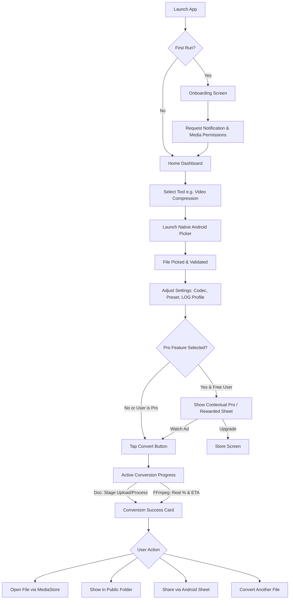

# CONVERTIX (ALLFORMAT MEDIA CONVERTER)
## Complete Standalone UI/UX Redesign Brief & Product Design Specification
**Document Version:** 2.0.0-REDESIGN  
**Target Platforms:** Android (Google Play Store Live App, Package: `com.allformat.converter`), iOS Ready  
**SDK Targets:** Android Min SDK 24 (Android 7.0 Nougat), Target SDK 36 (Android 16), Compile SDK 36  
**Document Purpose:** Standalone master specification for AI design systems (Figma AI, Google Stitch, Galileo, v0) and human product designers with zero access to the underlying codebase.

---

## 1. PROJECT OVERVIEW AND SCOPE

### 1.1 Product Summary
**Convertix** (published on the Google Play Store as *AllFormat Media Converter*, package `com.allformat.converter`) is an on-device and cloud-hybrid utility application engineered to convert, compress, extract, and manipulate media and documents across all major file formats. The application bridges the gap between high-end creative workflows and everyday file-utility needs by providing 100% on-device, private, zero-bandwidth media processing (via FFmpegKit and pure Dart decoders) alongside a high-fidelity, secure cloud backend (LibreOffice and PyMuPDF running on isolated micro-containers) for complex document conversions. Convertix processes everything from mobile camera snapshots and WhatsApp voice notes to professional multi-gigabyte camera LOG/HDR drone footage and multi-page corporate PDFs without user account friction or subscription entrapment.

### 1.2 Problem Statement & Value Proposition
* **The Problem:** Mobile users frequently encounter incompatible formats (e.g., Apple HEIC on Windows, camera MOV files on Android, WebM audio in legacy car players, large multi-page PDFs needing extraction). Existing mobile converters are plagued by intrusive ad walls, mandatory cloud uploads of sensitive personal files, aggressive paywalls, lost files hidden in obscure app-private directories, and deceptive fake progress indicators.
* **The Solution:** Convertix delivers predictable, immediate conversions with transparent processing architecture (local media processing stays on the device; cloud document processing deletes files within 30 seconds), guaranteed public storage placement (`DCIM/`, `Movies/`, `Music/`, `Documents/`), native Android system picker integration without invasive storage permissions, and honest progress feedback.

### 1.3 User Personas & Target Audience

| Persona | Demographics & Context | Primary Goals | Frustrations & Pain Points | Key Tools Used |
|---|---|---|---|---|
| **Persona A: Casual Casey (Daily Mobile User)** | Age 18–45, mid-tier Android phone (Redmi, Samsung Galaxy A, Realme). Frequently uses WhatsApp, Instagram, TikTok. | Convert received files to play on device; convert video clips to MP3; compress large videos to share on messaging apps under 25MB limits. | Confused by technical terms (CRF, AAC, bitrate); scared of losing files; hates popup ads that trick them into clicks. | Video to Audio, Video Compression, Image Converter |
| **Persona B: Student / Office Worker Sam** | Age 19–35, working with college assignments, receipts, government forms, Office decks. | Combine lecture slides or receipt photos into single PDF; convert DOCX/PPTX to PDF; make documents greyscale to save printer toner; split PDF pages. | Cloud converters demanding email signups; formatted tables breaking during DOCX→PDF; slow uploads on cellular data. | Image to PDF, Document Convert, Merge PDF, Split PDF, Greyscale PDF |
| **Persona C: Content Creator / Drone Pilot Chris** | Age 22–40, shoots 4K 10-bit LOG/HDR video on Sony Alpha (S-Log3), DJI Mini/Mavic (D-Log M), iPhone (HLG), or Canon (C-Log). | Tone-map flat LOG footage to standard BT.709 color space directly on phone/tablet for instant client previews or social reels without firing up Premiere/DaVinci. | Desktop software is tethered; mobile tools crush dynamic range or output oversaturated magenta/green color casts; complex LUT importing on mobile is broken. | Video Compression (LOG tone mapping), Video Converter (4K H.265/H.264) |
| **Persona D: Low-End Hardware User Dev** | Age 16–60, Android Go or 3–5 year old phone (2GB–3GB RAM, limited local storage, spotty 4G connection). | Convert files reliably without app crashing due to Out-Of-Memory (OOM) or thermal throttling; clear storage quickly. | Heavy animations causing UI freeze; apps crashing during large file renders; complex blur/glass effects lagging. | Audio Converter, Video Compression (Small preset), Tool Settings |

### 1.4 Platform Specifications
* **Primary Form Factor:** Android Smartphones (Portrait primary, 360dp to 480dp width classes).
* **Secondary Form Factors:** Android Foldables (Unfolded 600dp–840dp) and Android Tablets (840dp+ landscape/portrait responsive master-detail layouts).
* **OS Support Range:** Android 7.0 (API 24, Nougat) up to Android 16 (API 36, Baklava).
* **System Design Language:** Material 3 (Material You) baseline enriched with tailored, high-performance translucent layering, crisp micro-interactions, and accessible typography.
* **Touch Target Standard:** Strict minimum touch target of 48×48dp across all interactive elements (buttons, menu triggers, slider thumbs, chips).

### 1.5 In Scope vs. Out of Scope for Redesign

```
┌────────────────────────────────────────────────────────────────────────┐
│                              SCOPE MATRIX                              │
├───────────────────────────────────┬────────────────────────────────────┤
│ IN SCOPE (Design Overhaul)        │ OUT OF SCOPE (Engine Unchanged)    │
├───────────────────────────────────┼────────────────────────────────────┤
│ • Complete UI visual overhaul     │ • Core FFmpegKit compilation flags │
│ • Ergonomic 3-tab navigation shell│ • Backend LibreOffice / PyMuPDF API│
│ • Unified Conversion Progress/Card│ • Elimination of native pickers    │
│ • History & task management UI    │ • Multi-track audio timeline edit  │
│ • Store / Paywall presentation    │ • Non-linear video clip trimming   │
│ • Tool settings & folder manager  │ • OCR text recognition engine      │
│ • Design tokens & component lib   │ • Custom cloud storage sync (Drive)│
│ • Handoff prompts for Stitch/Figma│ • Desktop / Web standalone UI      │
└───────────────────────────────────┴────────────────────────────────────┘
```

### 1.6 Redesign Business & UX Goals
1. **Accelerate Time-to-First-Conversion (<10s):** Minimize screen friction from home launch to active conversion trigger to under 3 taps.
2. **Elevate Perceived Value of Pro / In-App Purchases:** Transform the Store from a plain catalog into a premium, transparent offering showcasing Filmmaker Video Pack (LOG/HDR), Document Master Pack, and Lifetime All-Access.
3. **Achieve Policy-Compliant, Ethical Ad Monetization:** Protect user trust and prevent AdMob strike penalties by isolating banners from tap zones, eliminating surprise interstitials, and utilizing opt-in rewarded ad unlocks.
4. **Alleviate User Anxiety:** Eliminate confusing technical jargon with inline micro-explainers, guarantee visible public folder placements, and implement accurate ETA/stage indicators.

---

## 2. COMPLETE FEATURE INVENTORY

The following inventory details all existing features alongside strategically proposed UX features for the redesign.

| Feature ID | Feature Name | Category | Description | Inputs / Outputs | User-Adjustable Parameters | Status | Screen Location | Monetization Tier |
|---|---|---|---|---|---|---|---|---|
| **FEAT-01** | Image Converter | Image | On-device format transcoding using pure Dart `package:image` with EXIF preservation. | **In:** JPG, JPEG, PNG, WEBP, BMP, TIFF<br>**Out:** JPG, PNG, WEBP, BMP, TIFF | • Target format<br>• Lossy quality slider (10%–100%, step 5%, def 90% for JPG/WEBP) | **Existing** | `/image-converter` | Free (Ad-supported) |
| **FEAT-02** | Video to Audio | Audio / Video | High-speed audio track extraction via FFmpegKit `-vn -acodec`. | **In:** MP4, MKV, AVI, MOV, WEBM, FLV, TS, 3GP, M4V<br>**Out:** MP3, AAC, WAV, FLAC, OGG | • Target audio format<br>• Bitrate selector (64, 128, 192, 320 kbps; hidden for lossless WAV/FLAC) | **Existing** | `/video-to-audio` | Free (Ad-supported) |
| **FEAT-03** | Audio Converter | Audio | On-device audio transcoding across compressed and uncompressed formats. | **In:** MP3, AAC, M4A, WAV, FLAC, OGG, OPUS, AIFF, WMA, AMR<br>**Out:** MP3, AAC, WAV, FLAC, OGG, OPUS, AIFF | • Target format<br>• Bitrate selector (64, 128, 192, 320 kbps; lossy only) | **Existing** | `/audio-converter` | Free (Ad-supported) |
| **FEAT-04** | Video Converter | Video | Container transcoding and spatial downscaling/upscaling via FFmpegKit. | **In:** MP4, MKV, AVI, MOV, WEBM, FLV, TS, 3GP, M4V, WMV<br>**Out:** MP4 (H.264), MP4 (H.265), MKV, MOV, WEBM, AVI, TS, 3GP | • Target container/codec<br>• Resolution (Original, 4K 2160p, 2K 1440p, 1080p, 720p, 480p) | **Existing** | `/video-converter` | Free (4K/2K gated or Pro) |
| **FEAT-05** | Video Compression (Standard) | Video | High-efficiency bitrate reduction using Constant Rate Factor (CRF). | **In:** MP4, MKV, AVI, MOV, WEBM, FLV, TS, 3GP, M4V, WMV<br>**Out:** MP4 | • Codec (H.264 / H.265)<br>• Quality Preset (High CRF 18, Balanced CRF 23, Small CRF 28)<br>• Resolution cap | **Existing** | `/video-compression` | Free (Ad-supported) |
| **FEAT-06** | Video Compression (LOG/HDR) | Video | Tone-mapping flat camera/drone profiles to BT.709 via FFmpeg `zscale` + `tonemap` filters. | **In:** Professional camera footage (Sony, Canon, DJI, Panasonic, iPhone)<br>**Out:** MP4 (BT.709 SDR) | • Profile selection (11 profiles: S-Log2/3, D-Log/M, C-Log1/2/3, V-Log/L, HLG, HDR10)<br>• Preset & Codec | **Existing** | `/video-compression` | Pro / Filmmaker Pack / Rewarded Ad |
| **FEAT-07** | Image to PDF | Document | Multi-image compilation into a single structured A4 PDF document via cloud PyMuPDF. | **In:** 1 to 50 Images (JPG, PNG, WEBP, BMP, TIFF)<br>**Out:** Single PDF | • Multi-file input list<br>• Drag-to-reorder images [PROPOSED] | **Existing** (Reorder is **PROPOSED**) | `/image-to-pdf` | Free (Max 50MB) |
| **FEAT-08** | Document Convert | Document | Multi-format office document transcoding via cloud LibreOffice headless engine. | **In:** DOCX, XLSX, PPTX, ODT, ODS, ODP, RTF, TXT, CSV<br>**Out:** PDF, DOCX, XLSX, PPTX, ODT, ODS, ODP, RTF, TXT, CSV | • Target document format | **Existing** | `/document-convert` | Free (Max 50MB) |
| **FEAT-09** | Greyscale PDF | Document | Converts colored PDF documents into neutral grayscale using PyMuPDF vector processing. | **In:** Color PDF<br>**Out:** Monochromatic PDF | • None (Automatic vector & bitmap desaturation) | **Existing** | `/greyscale-pdf` | Free (Ad-supported) |
| **FEAT-10** | Merge PDF | Document | Concatenates 2 or more PDF documents into a single document in sequential order. | **In:** 2+ PDF files (Total ≤ 50MB)<br>**Out:** Combined PDF | • File selection order<br>• Drag-to-reorder list [PROPOSED] | **Existing** (Reorder is **PROPOSED**) | `/merge-pdf` | Free (Max 50MB) |
| **FEAT-11** | Split PDF | Document | Extracts pages or page ranges from a PDF into individual documents. | **In:** Single PDF<br>**Out:** Extracted PDF or ZIP of individual PDFs | • Split mode (Every N pages, custom range, specific page list) | **Existing** | `/split-pdf` | Free (Ad-supported) |
| **FEAT-12** | Active Tasks Bar & ETA | Utility | Global asynchronous progress monitoring with live % and cancel hooks. | **In:** Active job ID<br>**Out:** Cancel signal or completed status | • Cancel active task button | **Existing** | Shell Header / `/history` | Free |
| **FEAT-13** | Conversion History | Utility | Local Hive database logging of past jobs with real-time file management actions. | **In:** MediaStore URI & Hive DB<br>**Out:** Opened file, share sheet, renamed file, deleted file | • Search/filter [PROPOSED]<br>• Clear history<br>• Rename on-disk<br>• Delete on-disk | **Existing** | `/history` | Free |
| **FEAT-14** | Per-Tool Source Memory | Utility | Remembers preferred Android file picker per tool with 1-tap reset capability. | **In:** Android `Intent.createChooser` callback<br>**Out:** Component launch | • Reset preference per tool<br>• Reset all preferences | **Existing** | `/settings` | Free |
| **FEAT-15** | Public Folder Manager | Utility | MediaStore redirection across `DCIM`, `Movies`, `Music`, `Documents`. | **In:** User folder selection via SAF<br>**Out:** Content URI path routing | • Custom folder override<br>• Reset to default | **Existing** | `/tool-settings` | Free |
| **FEAT-16** | System Share Intent Handler | Utility | Receives files directly from external apps via Android "Open With / Share to". | **In:** `android.intent.action.SEND`<br>**Out:** Auto-selected tool route | • Tool selection confirmation | **PROPOSED** | `/share-landing` | Free |
| **FEAT-17** | Batch Conversion Queue | Utility | Sequential queue processing for multiple media files with global progress. | **In:** Multi-file picker selection<br>**Out:** Batch output list | • Pause / Resume / Cancel all<br>• Global settings apply | **PROPOSED** | `/batch-queue` | Pro / Rewarded Ad |
| **FEAT-18** | Rewarded Feature Unlock | Monetization | Watch a 30s opt-in video ad to unlock Pro features (e.g. 1 LOG conversion or 4K export). | **In:** Google AdMob Rewarded Ad<br>**Out:** Temporary 1-time feature unlock pass | • Opt-in confirmation dialog | **PROPOSED** | Contextual Bottom Sheet | Free User Incentive |

---

## 3. INFORMATION ARCHITECTURE AND NAVIGATION

### 3.1 Sitemap & Navigation Hierarchy

```
[ APP ROOT / INITIALIZATION ]
   ├── [0. Splash Screen] (Cold start, theme check, Hive DB open)
   └── [1. First-Launch Onboarding] (Permissions explainer: Storage/Media & Notifications)
           │
           ▼
[ PERSISTENT 3-TAB APP SHELL ]
   ├── TAB 1: [HOME DASHBOARD] (Route: `/`)
   │      ├── Pro Status Top Banner (Dynamic: Upgrade CTA vs. Active Pro Pill)
   │      ├── Category Filter Chips ([All], [Video], [Audio], [Image], [Documents]) [PROPOSED]
   │      ├── Media Tools Grid (5 Interactive Tool Tiles)
   │      │      ├── Image Converter (`/image-converter`)
   │      │      ├── Video to Audio (`/video-to-audio`)
   │      │      ├── Audio Converter (`/audio-converter`)
   │      │      ├── Video Converter (`/video-converter`)
   │      │      └── Video Compression (`/video-compression`)
   │      └── Document Tools Grid (5 Interactive Tool Tiles)
   │             ├── Image to PDF (`/image-to-pdf`)
   │             ├── Document Convert (`/document-convert`)
   │             ├── Greyscale PDF (`/greyscale-pdf`)
   │             ├── Merge PDF (`/merge-pdf`)
   │             └── Split PDF (`/split-pdf`)
   │
   ├── TAB 2: [HISTORY & ACTIVE TASKS] (Route: `/history`)
   │      ├── Active Tasks Section (Live cards: %, Elapsed, ETA, Stage, Cancel)
   │      ├── History Search & Date Grouping (Today, Yesterday, Earlier)
   │      ├── History Card Menu (Open, Show in Folder, Share, Rename, Delete)
   │      └── Clear All History Action (Modal prompt)
   │
   └── TAB 3: [SETTINGS & SYSTEM] (Route: `/settings`)
          ├── Convertix Pro & Store Entry Tile (Crown badge)
          ├── Appearance: Dark Mode Toggle
          ├── Tool Settings & Output Folders (`/tool-settings`)
          ├── Document Backend Status Indicator (Live Health Ping)
          ├── File Source Chooser Preferences (View & Reset remembered apps)
          ├── System Permissions Manager (Direct jump to Android OS App Settings)
          ├── About: App Version, Privacy Policy, Terms, Rate App
          └── Legal: Open Source Licenses (`/licenses`)

[ GLOBAL OVERLAY & PUSHED ROUTES ] (Pushed over shell with Back navigation)
   ├── [Tool Working Screens] (10 Dedicated screens with input, config, convert, progress)
   ├── [Store / Paywall Screen] (`/store` - Subscriptions, Non-consumables, Credit Packs)
   ├── [Batch Conversion Queue] (`/batch-queue`) [PROPOSED]
   ├── [Share-Intent Landing Screen] (`/share-landing`) [PROPOSED]
   ├── [Contextual Pro Upsell Bottom Sheet] (Gated 4K / LOG profiles)
   ├── [Rewarded-Ad Unlock Sheet] (Watch ad for 1 free Pro conversion)
   └── [System Modal Dialogs] (Rename, Delete confirmation, Low storage alert)
```

### 3.2 Navigation Model & Back-Stack Rules
* **Shell Navigation:** Flutter `go_router` with `StatefulShellRoute.indexedStack`. Switching tabs preserves scroll position, input selections, and ongoing conversion state across tabs.
* **Tool Screen Push:** When a user taps a tool card on Home, the tool screen is pushed onto the root navigator (`parentNavigatorKey: _rootNavigatorKey`), covering the bottom navigation bar to provide maximum vertical space for controls and prevent accidental tab-switching during configuration.
* **Back-Press Hierarchy:**
  * While conversion is **Active**: Back button does *not* abandon the task; it presents a soft warning dialog ("Conversion in progress. Keep running in background? [Run in Background] [Cancel Conversion]").
  * While in **Success / Error** state: Back button resets the tool and returns to Home.
  * In Sub-screens (`/store`, `/tool-settings`, `/licenses`): Back button pops back to the originating tab.
  * On Home Tab: System back button exits the app.

### 3.3 Primary User Flows (Step-by-Step)



#### Detailed Text Flows

1. **First Launch & Permission Onboarding Flow:**
   * User opens app $\rightarrow$ Splash displays branded logo for 400ms $\rightarrow$ Router detects `has_seen_onboarding == false` $\rightarrow$ Navigates to `/onboarding`.
   * User views clear explanation of *Media Management* (rename/delete) and *Notifications* (background completion).
   * User taps `Continue` $\rightarrow$ Android OS permission prompts fire sequentially $\rightarrow$ Regardless of Allow/Deny, `has_seen_onboarding` is set to `true` in SharedPreferences $\rightarrow$ App transitions to Home (`/`).
2. **First Conversion Flow (Standard Media Tool):**
   * User taps "Video to Audio" on Home $\rightarrow$ Screen loads with idle state $\rightarrow$ User taps "Select Video".
   * Native Android Intent Chooser launches (or remembered app directly) $\rightarrow$ User selects `clip.mp4`.
   * File extension validated against allowed list. File details (name, size) populate input card.
   * Format dropdown defaults to `MP3`, bitrate defaults to `192 kbps`. User selects `320 kbps`.
   * User taps "Convert" $\rightarrow$ Ad banner at screen bottom fades out $\rightarrow$ Progress card animates in with linear progress indicator, elapsed counter, percentage, and ETA.
   * FFmpeg completes $\rightarrow$ Progress card transitions to Success Card with file metadata $\rightarrow$ Three action buttons: `[Open File]`, `[Show in Folder]`, `[Share]`. Bottom banner ad reappears.
3. **Batch Conversion Flow [PROPOSED]:**
   * User toggles "Batch Mode" or multi-selects files in "Merge PDF" or "Image to PDF".
   * App presents the Batch Queue Screen listing each item with thumbnail, name, size, and individual status icon.
   * User taps "Convert All" $\rightarrow$ Items transition sequentially from `Pending` $\rightarrow$ `Processing (with mini %)` $\rightarrow$ `Complete`.
   * Total queue progress bar at top updates; completion sound/haptic triggers when all finish.
4. **Share Intent Flow ("Open With Convertix") [PROPOSED]:**
   * User selects a video in WhatsApp/Gallery $\rightarrow$ Taps system Share $\rightarrow$ Selects "Convertix".
   * App opens `/share-landing` with file pre-loaded $\rightarrow$ Dynamic sheet suggests compatible tools: "Extract Audio (Video to Audio)", "Compress Video", "Change Container".
   * User taps chosen tool $\rightarrow$ Routes directly into tool screen with file pre-attached $\rightarrow$ User adjusts settings and converts.
5. **Upgrading to Pro / Store Flow:**
   * User taps "Upgrade" button in AppBar or hits a locked feature (e.g. Sony S-Log3) $\rightarrow$ Navigates to `/store`.
   * Store presents hero card, 3 tabs: "Pro Plans" (Yearly, Monthly, Lifetime), "Feature Packs" (Filmmaker, Document), "Credit Packs".
   * User selects "Pro Annual Pass (₹299/yr - Save 50%)" $\rightarrow$ Taps "Continue to Google Play".
   * Google Play Billing sheet renders $\rightarrow$ User confirms biometric payment $\rightarrow$ Play Billing completes $\rightarrow$ App listens to purchase stream, marks entitlement in secure cache, triggers celebration modal $\rightarrow$ Pro badge appears app-wide; all ads instantly disappear.

---

## 4. SCREEN-BY-SCREEN SPECIFICATION

### 4.1 Screen 01: Splash Screen
* **Purpose:** Initial visual handshake during cold boot while Flutter initializes Dart isolates, loads `.env`, connects Hive DB, and checks SharedPreferences.
* **Entry / Exit:** OS App Icon tap $\rightarrow$ Transitions to `/onboarding` (first launch) or `/` (returning).
* **Essential Elements:**
  * `[MUST]` Central Convertix Vector Logo (Deep Teal & Electric Cyan intertwining glyph).
  * `[MUST]` App Title "Convertix" in bold geometric typography.
  * `[SHOULD]` Subtitle "Fast • Private • All-Format Converter".
  * `[SHOULD]` Subtle bottom indeterminate pulse line indicator.
  * `[OPTIONAL]` App version stamp at screen bottom center (`v1.0.9`).
* **Content Hierarchy:** 1st: App Logo (instant recognition); 2nd: App Title; 3rd: Loading indicator.
* **States:** Default (Branded splash background); Error (Fatal initialization error modal with "Restart App").
* **Interactions & Motion:** Logo scales from 0.85 to 1.0 with smooth ease-out-cubic (300ms); opacity fades to 1.0; exit transition is a seamless 250ms cross-fade into Home.
* **Microcopy:**
  * Title: "Convertix"
  * Tagline: "Fast • Private • All-Format Converter"
* **Ads / Monetization:** Zero ads. Clean, premium entry.
* **Accessibility:** Screen announced by TalkBack as "Convertix, media converter starting up". High-contrast logo on dark/light background.

---

### 4.2 Screen 02: Permissions Onboarding Screen
* **Purpose:** Transparently explain why Convertix benefits from Android system permissions before triggering OS permission dialogs.
* **Entry / Exit:** Entered only on first run $\rightarrow$ Exits permanently to `/` upon tapping "Continue".
* **Essential Elements:**
  * `[MUST]` Top illustration/icon: Shield with checkmark (`LucideIcons.shieldCheck`) in tinted container.
  * `[MUST]` Headline: "Welcome to Convertix".
  * `[MUST]` Descriptive body: "Convertix needs permission to manage files and keep you updated on conversions."
  * `[MUST]` Permission Card 1: Media Management (`LucideIcons.folderEdit`) — explains in-app renaming and deleting of converted files without gallery clutter.
  * `[MUST]` Permission Card 2: Notifications (`LucideIcons.bellRing`) — explains background conversion completion alerts.
  * `[MUST]` Primary Action Button: "Continue" (Full-width 56dp tall).
  * `[SHOULD]` "Skip for Now" secondary text button.
  * `[OPTIONAL]` Privacy reassurance pill: "Your files never leave your device without your permission."
* **Content Hierarchy:** 1st: Welcome headline; 2nd: Permission value cards; 3rd: Primary "Continue" CTA.
* **States:** Default (Ready to request); Requesting (Button displays circular loading spinner); Denied inline notice.
* **Interactions & Motion:** Cards slide up with staggered 50ms delay. Button press triggers haptic click (`HapticFeedback.lightImpact`).
* **Microcopy:**
  * Header: "Welcome to Convertix"
  * Subtitle: "Before we begin, Convertix needs a few permissions to give you the best experience."
  * Tile 1 Title: "Media Management"
  * Tile 1 Body: "Allows Convertix to rename and delete your converted files directly from the app."
  * Tile 2 Title: "Notifications"
  * Tile 2 Body: "Notifies you when long video or document conversions complete in the background."
  * CTA Button: "Continue"
  * Secondary: "Skip for now"
* **Ads / Monetization:** No ads permitted on onboarding (AdMob policy compliant).
* **Accessibility:** Every card has explicit semantic heading trait; TalkBack reads benefit description before button.

---

### 4.3 Screen 03: Home Dashboard (Tools Grid)
* **Purpose:** Central command center providing instant access to all 10 tools, store upgrade, and active tasks.
* **Entry / Exit:** Root shell tab 1. Pushes into individual tool screens or settings.
* **Essential Elements:**
  * `[MUST]` Top AppBar with App Title "Convertix" in bold typeface.
  * `[MUST]` Pro Upgrade / Active Badge in AppBar (Gold Crown icon + "UPGRADE" for free users; Emerald Check + "PRO" for subscribers).
  * `[MUST]` Settings Action Icon button (`LucideIcons.settings`).
  * `[MUST]` Hero Pro Banner (for free users): Gradient container showcasing Pro benefits with "Upgrade" CTA.
  * `[MUST]` Section 1 Header: "Media Tools" with subtitle "100% on-device • Zero data usage".
  * `[MUST]` Media Tools Grid (2 columns, 5 cards): Image Converter, Video to Audio, Audio Converter, Video Converter, Video Compression.
  * `[MUST]` Section 2 Header: "Document Tools" with subtitle "Secure cloud engine • Deleted in 30s".
  * `[MUST]` Document Tools Grid (2 columns, 5 cards): Image to PDF, Document Convert, Greyscale PDF, Merge PDF, Split PDF.
  * `[SHOULD]` Tool Category Filter Chips ([All Tools], [Video], [Audio], [Images], [Documents], [PDF]) [PROPOSED].
  * `[SHOULD]` Active Task Floating Pill if background task is running (shows live % and spinner).
  * `[OPTIONAL]` "Recent Conversions" quick horizontal carousel preview at top [PROPOSED].
* **Content Hierarchy:** 1st: Tool Grid cards (visual discovery); 2nd: Pro Hero banner; 3rd: AppBar utility actions.
* **States:** Free User view (Displays Pro banner and Upgrade button); Pro User view (Hides banner, displays elegant Pro badge); Task active view (Shows sticky floating progress bar above bottom nav).
* **Interactions & Motion:** Tool cards have subtle elevation lift (+2dp) and 0.98 scale depression on press; tap opens tool with shared-axis page transition.
* **Microcopy:**
  * Banner Title: "Get Convertix Pro & Bundles"
  * Banner Subtitle: "Remove ads, unlock 4K video & camera LOG profiles"
  * Section 1: "Media Tools"
  * Section 1 Sub: "On-device processing • Fast & private"
  * Section 2: "Document Tools"
  * Section 2 Sub: "High-fidelity cloud conversion • Auto-deleted"
* **Ads / Monetization:** No banner on Home tab (preserves clean dashboard aesthetics); Pro banner links to `/store`.
* **Accessibility:** Minimum card height 120dp; TalkBack announces tool name and description; category chips support horizontal keyboard navigation.

---

### 4.4 Screen 04: Format & Tool Selection (Category Switcher)
* **Purpose:** Quick-switch modal or tab allowing a user inside any tool to pivot to an alternative tool without popping back to Home.
* **Entry / Exit:** Triggered from Tool Screen header via tool title dropdown icon.
* **Essential Elements:**
  * `[MUST]` Bottom sheet handle and title "Switch Tool".
  * `[MUST]` Two tabs or segmented pills: "Media Tools (5)" and "Document Tools (5)".
  * `[MUST]` List items showing tool icon, tool name, and supported extensions pill (e.g. "MP4, MKV $\rightarrow$ MP3, WAV").
  * `[SHOULD]` Currently active tool highlighted with checkmark.
* **Microcopy:** Title: "Switch Conversion Tool"; Helper: "Select a tool to change your current operation."
* **Accessibility:** Dismissible via swipe down, Scrim tap, or Back key.

---

### 4.5 Screen 05: File Selection Surface (Native Intent Chooser & Source Picker)
* **Purpose:** Trigger Android's native file-source resolver (`Intent.createChooser`) while providing custom fallback error guidance if unsupported files are picked.
* **Entry / Exit:** Triggered by tapping "Select [File Type]" button in any tool screen.
* **Essential Elements:**
  * `[MUST]` Outlined/Filled Picker Button (minimum 56dp height) with category icon (`LucideIcons.uploadCloud` or tool specific).
  * `[MUST]` Dynamic Button Label: "Select Video", "Select Audio", "Select Images", "Select PDF", "Select Document".
  * `[MUST]` Selected File Card (replaces button once picked): File name (truncated with middle ellipsis), file size in KB/MB, file extension badge, and "Change" button.
  * `[SHOULD]` Remembered App notice text below button: "Opens with Files by Google [Change]".
* **States:** Default (No file picked, button active); Busy (Picker open in system); Selected (Card showing file metadata); Incompatible file selected (Inline red alert snackbar: "This tool only accepts [formats]. You selected a .xyz file.").
* **Microcopy:**
  * Default Label: "Select File"
  * Change Button: "Change"
  * Incompatible Error: "This tool only accepts {allowed_formats}. Please select a compatible file."
  * Cancelled Notice: Silent cancel (no annoying error popups when user backs out of picker).
* **Accessibility:** File size announced with localized decimal separator; "Change File" button has explicit label.

---

### 4.6 Screens 06–10: Media Tool Configuration Screens

#### Screen 06: Image Converter (`/image-converter`)
* **Purpose:** Transcode image formats and tune lossy compression levels on-device.
* **Essential Elements:**
  * `[MUST]` File Picker Card (`jpg`, `jpeg`, `png`, `webp`, `bmp`, `tiff`).
  * `[MUST]` Output Format Dropdown (`JPG`, `PNG`, `WEBP`, `BMP`, `TIFF`).
  * `[MUST]` Quality Slider (10% to 100%, visible only when JPG or WEBP output is chosen). Default 90%.
  * `[MUST]` Primary Action Button: "Convert Image" (Enabled only when file selected).
  * `[MUST]` Unified Conversion Progress / Result Card.
  * `[MUST]` Bottom Anchored Adaptive AdMob Banner.
* **Microcopy:** Quality Slider Label: "Image Quality ({val}%) — Lower percentage reduces file size."; Button: "Convert Image".

#### Screen 07: Video to Audio (`/video-to-audio`)
* **Purpose:** Extract audio streams from video containers.
* **Essential Elements:**
  * `[MUST]` File Picker Card (`mp4`, `mkv`, `avi`, `mov`, `webm`, `flv`, `ts`, `3gp`, `m4v`).
  * `[MUST]` Output Format Dropdown (`MP3`, `AAC`, `WAV`, `FLAC`, `OGG`).
  * `[MUST]` Audio Bitrate Dropdown (`64 kbps`, `128 kbps`, `192 kbps (Standard)`, `320 kbps (High Quality)`). Automatically hidden for lossless formats (WAV, FLAC).
  * `[MUST]` Convert Action Button: "Extract Audio".
  * `[MUST]` Bottom AdMob Banner.
* **Microcopy:** Bitrate Label: "Audio Bitrate"; Lossless Note: "WAV & FLAC are lossless formats; bitrate selection is disabled."; Button: "Extract Audio".

#### Screen 08: Audio Converter (`/audio-converter`)
* **Purpose:** Transcode audio files between different lossy and lossless formats.
* **Essential Elements:**
  * `[MUST]` File Picker Card (`mp3`, `aac`, `m4a`, `wav`, `flac`, `ogg`, `opus`, `aiff`, `wma`, `amr`).
  * `[MUST]` Output Format Dropdown (`MP3`, `AAC`, `WAV`, `FLAC`, `OGG`, `OPUS`, `AIFF`).
  * `[MUST]` Bitrate Dropdown (64, 128, 192, 320 kbps; hidden for lossless).
  * `[MUST]` Convert Action Button: "Convert Audio".
* **Microcopy:** Button: "Convert Audio".

#### Screen 09: Video Converter (`/video-converter`)
* **Purpose:** Convert video container formats and change display resolutions.
* **Essential Elements:**
  * `[MUST]` File Picker Card (`mp4`, `mkv`, `avi`, `mov`, `webm`, `flv`, `ts`, `3gp`, `m4v`, `wmv`).
  * `[MUST]` Output Container Dropdown (`MP4 (H.264)`, `MP4 (H.265)`, `MKV`, `MOV`, `WEBM`, `AVI`, `TS`, `3GP`).
  * `[MUST]` Resolution Dropdown (`Original`, `4K (2160p)`, `2K (1440p)`, `1080p Full HD`, `720p HD`, `480p SD`).
  * `[SHOULD]` Pro lock icon on `4K` and `2K` options for free users.
  * `[MUST]` Convert Action Button: "Convert Video".
* **Microcopy:** Resolution Label: "Output Resolution"; 4K Tooltip: "4K & 2K exports require Convertix Pro or Rewarded Pass."; Button: "Convert Video".

#### Screen 10: Video Compression (`/video-compression`) — [KEY DIFFERENTIATOR]
* **Purpose:** Compress heavy camera/drone videos with optional professional LOG/HDR to BT.709 SDR tone-mapping.
* **Essential Elements:**
  * `[MUST]` File Picker Card (accepts all standard video containers).
  * `[MUST]` LOG/HDR Profile Dropdown:
    * `Standard SDR` (regular smartphone / web video)
    * `S-Log2 (Sony A7 series)`
    * `S-Log3 (Sony FX/Cinema series)`
    * `D-Log (DJI Drones)`
    * `D-Log M (DJI Action/Pocket/Air)`
    * `C-Log (Canon EOS)`
    * `C-Log2 (Canon Cinema)`
    * `C-Log3 (Canon Cinema)`
    * `V-Log (Panasonic Lumix GH series)`
    * `V-Log L (Panasonic lightweight)`
    * `HLG (Broadcast / iPhone HDR / Cinematic)`
  * `[MUST]` Pro Gold Lock badge next to all camera LOG profiles for free users.
  * `[MUST]` Compression Quality Preset Dropdown:
    * `Balanced (CRF 23)` — Recommended for Instagram, TikTok, YouTube
    * `High Quality (CRF 18)` — Near-lossless archival quality
    * `Small File (CRF 28)` — Optimized for WhatsApp & Email attachments
  * `[MUST]` Video Codec Dropdown (`H.264 (Universal Compatibility)` / `H.265 (Smaller Size, Modern Devices)`).
  * `[MUST]` Resolution Selector (`Original`, `4K`, `2K`, `1080p`, `720p`).
  * `[MUST]` Convert Action Button: "Compress Video".
* **Microcopy:**
  * Profile Helper: "LOG profiles apply hardware-tested Hable/Reinhard BT.709 color reconstruction."
  * Preset Helper: "Balanced maintains visual fidelity while cutting file size by 50–70%."
  * Button: "Compress Video"

---

### 4.7 Screens 11–15: Document Tool Configuration Screens

#### Screen 11: Document Convert (`/document-convert`)
* **Purpose:** Transcode office documents, spreadsheets, and text files via LibreOffice cloud.
* **Essential Elements:**
  * `[MUST]` File Picker Button (`docx`, `xlsx`, `pptx`, `odt`, `ods`, `odp`, `rtf`, `txt`, `csv`).
  * `[MUST]` Target Format Dropdown (`PDF`, `DOCX`, `XLSX`, `PPTX`, `ODT`, `ODS`, `ODP`, `RTF`, `TXT`, `CSV`).
  * `[MUST]` Privacy Notice: "Processed via encrypted TLS. Auto-deleted within 30 seconds."
  * `[MUST]` Convert Action Button: "Convert Document".
  * `[MUST]` Stage-based Progress Indicator: "Uploading..." $\rightarrow$ "Converting on Cloud..." $\rightarrow$ "Downloading...".

#### Screen 12: Image to PDF (`/image-to-pdf`)
* **Purpose:** Compile single or multiple images into a clean PDF document.
* **Essential Elements:**
  * `[MUST]` Multi-file Image Picker Button (Allows multiple selection).
  * `[MUST]` Selected Images Count Pill (e.g., "14 images selected").
  * `[SHOULD]` Horizontal Reorderable Thumbnail Strip [PROPOSED]: Drag images to change page order.
  * `[MUST]` Page Orientation / Size default note: "A4 Page, auto-scaled with aspect ratio preserved".
  * `[MUST]` Convert Action Button: "Create PDF".

#### Screen 13: Greyscale PDF (`/greyscale-pdf`)
* **Purpose:** Convert color PDF documents into greyscale vector PDFs for printing.
* **Essential Elements:**
  * `[MUST]` PDF File Picker Button (`application/pdf`).
  * `[MUST]` Feature Explainer Card: "Desaturates photos, vectors, and backgrounds to save printer ink while preserving crisp text clarity."
  * `[MUST]` Convert Action Button: "Make Greyscale".

#### Screen 14: Merge PDF (`/merge-pdf`)
* **Purpose:** Combine 2 or more PDF files into a single document.
* **Essential Elements:**
  * `[MUST]` Multi-file PDF Picker Button (`allowMultiple: true`).
  * `[MUST]` Selected PDF list showing file names and page counts.
  * `[MUST]` Minimum 2 files validation: If < 2 files selected, Convert button is disabled with helper: "Please select at least 2 PDFs to merge."
  * `[MUST]` Convert Action Button: "Merge PDFs".

#### Screen 15: Split PDF (`/split-pdf`)
* **Purpose:** Extract specific pages or split multi-page PDFs.
* **Essential Elements:**
  * `[MUST]` Single PDF File Picker Button.
  * `[MUST]` Split Mode Selector:
    * Option A: `Split every N pages` (Numeric input field, default `1`).
    * Option B: `Extract page range` [PROPOSED] (Text field: e.g. `1-5, 8, 11-14`).
  * `[MUST]` ZIP archive notice: "Splitting into multiple files will save individual PDFs into your Documents folder."
  * `[MUST]` Convert Action Button: "Split PDF".

---

### 4.8 Screen 16: Batch Queue Screen [PROPOSED]
* **Purpose:** Dedicated queue management surface for batch conversions.
* **Entry / Exit:** Accessible when user selects multiple files in media converters or via History tab.
* **Essential Elements:**
  * `[MUST]` Overall Queue Progress Header (e.g. "Converting 3 of 8 items • 42% complete • ETA: 1m 15s").
  * `[MUST]` Master Action Buttons: `[Pause All]`, `[Cancel All]`.
  * `[MUST]` Reorderable Queue List Item:
    * Thumbnail preview or format icon.
    * Source filename and file size.
    * Target format tag.
    * Item Status: `Queued`, `Processing (mini progress bar)`, `Completed`, `Failed`.
    * Cancel item button (`LucideIcons.x`).
  * `[SHOULD]` "Keep Screen Awake" toggle switch.
* **States:** Active batch running; Batch paused; Batch completed with summary dialog ("8 files successfully converted").

---

### 4.9 Screen 17: Conversion Progress Surface (Unified Progress Card)
* **Purpose:** Provide honest, transparent progress feedback during execution without misleading users.
* **Essential Elements:**
  * `[MUST]` Processing Header with Animated Icon (`Icons.hourglass_top` spinning / pulsing).
  * `[MUST]` Real Percentage Indicator (for FFmpeg tools: calculated via `statistics.getTime() / totalDuration * 100`).
  * `[MUST]` Stage Label (for Document tools: "Uploading file..." $\rightarrow$ "Processing on Server..." $\rightarrow$ "Downloading PDF...").
  * `[MUST]` Animated Smooth Linear Progress Bar (custom tweened curve).
  * `[MUST]` Elapsed Time Counter (`00:14`).
  * `[MUST]` Estimated Time Remaining (ETA) (Shown after initial 3 seconds for stable throughput calculation).
  * `[MUST]` Outlined Cancel Button (`Icons.close` + "Cancel").
* **States:**
  * *FFmpeg Real Progress:* Displays linear bar from 0% to 100% with live numeric %, elapsed, and ETA.
  * *Document Stage Progress:* Displays indeterminate animated shimmer progress with explicit stage text and elapsed counter; never fabricates a fake percentage bar.
  * *Cancelling State:* Button changes to disabled "Cancelling..." while FFmpeg session terminates or Dio request is aborted.

---

### 4.10 Screen 18: Conversion Success / Result Surface
* **Purpose:** Reward user upon completion, confirm exact file storage location, and provide instant primary actions.
* **Essential Elements:**
  * `[MUST]` Success Header: Emerald Checkmark icon (`Icons.check_circle`) + "Conversion Complete".
  * `[MUST]` File Result Card:
    * Output File Name (e.g. `wedding_clip_convertix.mp4`).
    * Output File Size (e.g. `18.4 MB` formatted).
    * Storage Destination Badge with Folder Icon: e.g. `Movies/Videos (Convertix)/`.
  * `[MUST]` Action Button 1 (Primary Filled): `[Open File]` (`Icons.open_in_new`).
  * `[MUST]` Action Button 2 (Secondary Outlined): `[Show in Folder]` (`Icons.folder_outlined`) — opens Android file manager or copies path.
  * `[MUST]` Action Button 3 (Secondary Outlined): `[Share]` (`Icons.share`) — opens native Android share sheet with file attached.
  * `[MUST]` Action Button 4 (Text Button): `[Convert Another]` (`Icons.refresh`) — resets tool state for next file.
  * `[SHOULD]` Size Reduction Metric (for Video Compression): e.g. "Saved 48.2 MB (64% smaller)".
  * `[OPTIONAL]` Pro soft upsell pill: "Enjoying Convertix? Remove all ads for just ₹29."
* **Interactions & Motion:** Success card pops in with subtle bouncy spring animation (`Curves.elasticOut`); checkmark performs a scale pulse; haptic success feedback fires.

---

### 4.11 Screen 19: Conversion Failure / Error Surface
* **Purpose:** Explain failures transparently with actionable recovery paths rather than cryptic crash codes.
* **Essential Elements:**
  * `[MUST]` Error Icon (`Icons.error_outline`) in Soft Red Container.
  * `[MUST]` Error Headline: "Conversion Failed".
  * `[MUST]` Human-Readable Explanation (Translates platform codes into plain English; e.g. "The selected video file appears to be corrupted or uses an unsupported codec.").
  * `[MUST]` Action Button 1: `[Retry Conversion]` (Primary Filled).
  * `[MUST]` Action Button 2: `[Pick Another File]` (Outlined).
  * `[SHOULD]` Diagnostic Details Accordion: "Show Technical Log" (expandable box showing sanitized FFmpeg / HTTP error snippet).
  * `[OPTIONAL]` "Report Issue" feedback link.
* **Microcopy:**
  * Codec Error: "We couldn't decode this video. Try converting to MP4 H.264 first."
  * Network Error: "Document server is temporarily unreachable. Please check your internet connection."
  * Low Storage: "Not enough free storage space on your device to save the output file."

---

### 4.12 Screen 20: History & Library Screen (`/history`)
* **Purpose:** Manage active background conversions and browse, inspect, share, rename, or delete past conversion files.
* **Entry / Exit:** Shell Navigation Tab 2.
* **Essential Elements:**
  * `[MUST]` Top AppBar: "History" with "Clear All" Trash icon button.
  * `[MUST]` Section 1: "Active Tasks" (Visible only when conversions are actively running).
    * Card per task: input filename, tool name, live %, stage/elapsed, and Cancel button.
  * `[MUST]` Section 2: Completed Conversions grouped into chronological sticky headers: `Today`, `Yesterday`, `Earlier`.
  * `[MUST]` History Item Card:
    * Category Format Icon (Image, Video, Audio, PDF).
    * Output Filename.
    * Tool Name tag & converted file size (e.g. `Video to Audio • 3.4 MB`).
    * Relative timestamp (e.g. `12 minutes ago`).
    * 3-Dot Overflow Menu Trigger (`LucideIcons.moreVertical`).
  * `[MUST]` Card Tap Interaction: Tapping anywhere on a completed card opens the file directly.
  * `[MUST]` Empty State View (When no conversions exist):
    * Large muted illustration (`LucideIcons.history`).
    * Title: "No conversions yet".
    * Body: "Your converted files will automatically appear here."
    * Action CTA: "Start a Conversion" (switches to Tab 1).
* **Interactions:** Swipe-to-delete gesture on cards with red background and undo snackbar.

---

### 4.13 Screen 21: File Actions Dialogs (History Sub-Surfaces)
* **Purpose:** Provide native file system modifications (Rename & Delete) via Android MediaStore.
* **Sub-Surfaces:**
  1. **Rename File Dialog:**
     * Title: "Rename File"
     * Input field pre-populated with current filename (autofocused).
     * Buttons: `[Cancel]`, `[Rename]`.
     * Permissions note: If Android 11+ requires consent, triggers system dialog.
  2. **Delete Confirmation Dialog:**
     * Title: "Delete File?"
     * Body: "This will permanently delete '[filename]' from your device storage."
     * Buttons: `[Cancel]`, `[Delete]` (Destructive red button).
  3. **Missing File Notice Card:**
     * If file was deleted or moved by user in another gallery app: Card displays inline warning "File no longer exists on disk" with `[Remove from History]` button.

---

### 4.14 Screen 22: Output Folder & Tool Settings (`/tool-settings`)
* **Purpose:** Configure default output formats, quality presets, and custom folder destinations per tool.
* **Entry / Exit:** Settings Tab $\rightarrow$ "Tool Settings".
* **Essential Elements:**
  * `[MUST]` List of all 10 tools with their current output folder path displayed.
  * `[MUST]` Tap opens Tool Settings Modal Dialog:
    * Default Output Format dropdown.
    * Default Quality slider (for image tools).
    * Custom Folder Row: Displays current public folder (e.g. `DCIM/Images (Convertix)/`).
    * `[Change Folder]` button: Launches Android SAF folder picker.
    * `[Reset to Default]` button.
* **Microcopy:** "Convertix saves files to public Android media folders so they immediately show up in your Gallery and Files apps."

---

### 4.15 Screen 23: Settings Screen (`/settings`)
* **Purpose:** Central application configuration, theme management, permission controls, and about metadata.
* **Entry / Exit:** Shell Navigation Tab 3.
* **Essential Elements:**
  * `[MUST]` Section 1: "Convertix Pro" — Gold card with Crown icon, linking to `/store`.
  * `[MUST]` Section 2: "General"
    * Dark Mode switch toggle (`LucideIcons.moon`).
    * Tool Settings entry (`LucideIcons.settings` $\rightarrow$ `/tool-settings`).
    * Clear History destructive tile (`LucideIcons.trash2`).
  * `[MUST]` Section 3: "Backend Status"
    * Document Server Health ping indicator: Green dot (Online), Orange (Connecting/Cold Start), Red (Offline). Tapping forces refresh.
  * `[MUST]` Section 4: "File Source Preferences"
    * Lists tools with remembered default picker apps.
    * Reset button per tool and "Reset All Sources" button.
  * `[MUST]` Section 5: "Permissions"
    * "Manage App Permissions" tile: Launches Android OS App Info settings.
  * `[MUST]` Section 6: "About"
    * Open Source Licenses (`/licenses`).
    * Privacy Policy (External Web Link).
    * Rate Convertix (Google Play Market intent).
    * Version display: e.g. "Version 1.0.9 (Build 16)".

---

### 4.16 Screen 24: Theme & Language Settings [PROPOSED]
* **Purpose:** Granular visual customization and multi-language localization selection.
* **Essential Elements:**
  * Theme Mode Radio selector: `System Default`, `Light Mode`, `Dark Mode`, `OLED True Black`.
  * Accent Color selector (Teal, Cyan, Indigo, Violet, Emerald).
  * App Language selector (English, Hindi, Spanish, French, German, Portuguese, Arabic, Indonesian).

---

### 4.17 Screen 25: Store / Premium Screen (`/store`)
* **Purpose:** Complete commercial showcase for Convertix Pro, feature packs, and conversion credit packs.
* **Entry / Exit:** Pushed from Home Banner, AppBar Upgrade button, Gated feature locks, or Settings.
* **Essential Elements:**
  * `[MUST]` Top AppBar with "Convertix Store" and `[Restore Purchases]` action text button.
  * `[MUST]` Hero Header: Lustrous gradient banner with Crown/Badge icon:
    * Title: "Unlock Convertix Pro"
    * Value Subtitle: "Ad-free experience, professional camera LOG tone mapping, and unlimited 4K conversions."
  * `[MUST]` Segmented Tab Bar (3 Tabs):
    * Tab 1: `Pro Plans` (Subscriptions & Lifetime)
    * Tab 2: `Feature Packs` (Non-consumable standalone bundles)
    * Tab 3: `Credit Packs` (Consumable conversion credits)
  * `[MUST]` Plan Cards (Tab 1):
    * Card 1: **Pro Annual Pass** (Highlighted with "BEST VALUE • SAVE 50%" badge, price `₹299 / year` (~₹25/mo), full feature checklist).
    * Card 2: **Pro Monthly Pass** (Price `₹49 / month`, flexible billing).
    * Card 3: **Lifetime All-Access** (Highlighted with "PAY ONCE • OWN FOREVER" badge, price `₹499 once`).
  * `[MUST]` Feature Pack Cards (Tab 2):
    * Card 1: **Remove Ads Permanently** (`₹29 once`, shield checkmark).
    * Card 2: **Filmmaker Video Pack** (`₹149 once`, Sony/Canon/DJI LOG profiles & 4K exports).
    * Card 3: **Document Master Pack** (`₹99 once`, no file size limits & priority cloud queue).
  * `[MUST]` Credit Pack Cards (Tab 3):
    * `50 Credits` (`₹19`), `200 Credits` (`₹49` Popular), `500 Credits` (`₹99` Best Value).
  * `[MUST]` Feature Comparison Table: Free vs. Pro matrix.
  * `[MUST]` Legal Footer: Google Play auto-renewal disclosure, Privacy Policy, Terms of Service, "Cancel anytime in Play Store subscriptions".
  * `[MUST]` Pending Transaction Overlay: Modal spinner "Connecting to Google Play...".
* **States:** Default (Catalog loaded); Pending payment; Purchase failed dialog; Active Pro state (Celebration banner "You own Convertix Pro!").
* **Microcopy:**
  * Guarantee: "Zero risk • 48-hour Google Play refund policy applies"
  * Cancel Info: "Subscriptions auto-renew annually. Cancel anytime in Google Play Store $\rightarrow$ Subscriptions."

---

### 4.18 Screen 26: Purchase Success Celebration Dialog
* **Purpose:** Immediate visual and emotional reward validating successful purchase.
* **Essential Elements:**
  * Lottie Confetti Animation trigger.
  * Crown / Gem Icon in gold gradient container.
  * Headline: "Welcome to Convertix Pro!"
  * Body: "All ads have been removed and pro features are unlocked across all your devices."
  * Action Button: "Start Converting" (Pops back to originating tool).
* **Interactions:** Haptic heavy impact pattern (`HapticFeedback.heavyImpact`).

---

### 4.19 Screen 27: Restore Purchases Status Dialog
* **Purpose:** Provide feedback when querying Google Play Billing cache for previous entitlements.
* **States:**
  * Checking: Spinner + "Querying Google Play for past purchases..."
  * Found: Checkmark + "Restored Pro Annual Pass successfully!"
  * None Found: Info icon + "No active purchases found for this Google account."

---

### 4.20 Screen 28: Rewarded-Ad Unlock Sheet [PROPOSED]
* **Purpose:** Monetize non-paying users by trading a 30s rewarded video ad for a single premium conversion (e.g. 1 S-Log3 conversion or 1 4K export).
* **Essential Elements:**
  * Bottom Sheet layout with Play Video icon (`LucideIcons.playCircle`).
  * Title: "Unlock with a Quick Video"
  * Body: "Watch a short 30-second sponsored ad to unlock this conversion for free."
  * Primary Button: `[Watch Video Ad]` (With video reel icon).
  * Secondary Button: `[Get Pro Pass instead]` (Links to Store).
  * Dismiss: `[Not Now]`.
* **Policy Compliance:** 100% opt-in. Never forces video playback automatically.

---

### 4.21 Screen 29: Contextual Locked Feature Bottom Sheet
* **Purpose:** Inline upsell when a user taps a gated item (e.g. 4K resolution or Canon C-Log profile).
* **Essential Elements:**
  * Title: "Pro Feature"
  * Feature highlight: e.g. "Canon C-Log Tone Mapping is part of the Filmmaker Video Pack."
  * Option 1: "Get Lifetime Filmmaker Pack — ₹149 once"
  * Option 2: "Watch Video to Unlock Once"
  * Option 3: "Unlock Everything with Pro — ₹299/yr"
  * Dismiss button: "Cancel"

---

### 4.22 Screens 30–33: System & Utility Modals

#### Screen 30: Privacy Policy, Terms & FAQ (`/help-faq`)
* Clean Markdown-rendered reader screen with collapsible FAQ accordions addressing file security, server deletion, and supported formats.

#### Screen 31: Open Source Licenses (`/licenses`)
* Flutter `LicensePage` wrapper detailing FFmpegKit LGPL/GPL disclosures and open source packages.

#### Screen 32: Rate-the-App Prompt Dialog
* Triggered after the user's 3rd successful conversion.
* Stars rating widget (1 to 5 stars). 4–5 stars redirects to Google Play Store; 1–3 stars opens in-app feedback sheet.
* Options: `[Rate on Play Store]`, `[Remind Me Later]`, `[No Thanks]`.

#### Screen 33: Update-Available In-App Prompt
* Google Play In-App Update API wrapper.
* Flexible update card: "New version of Convertix available with faster FFmpeg encoding." Buttons: `[Update Now]`, `[Later]`.

---

### 4.23 Screen 34: System Notifications (Foreground & Background)
* **Purpose:** OS-level notification tray presence when conversions execute in background.
* **Elements:**
  * *Ongoing Notification:* Small app icon, Title: "Converting video...", Body: `interview_convertix.mp4 • 48% • ETA: 35s`, Determinate native progress bar, Action Button: `[Cancel]`.
  * *Completion Notification:* Title: "Conversion Complete", Body: `wedding_clip_convertix.mp4 saved to Movies`, Action Button 1: `[Open]`, Action Button 2: `[Share]`.

---

### 4.24 Screen 35: Share-Intent Landing Screen (`/share-landing`) [PROPOSED]
* **Purpose:** Handles external files shared into Convertix.
* **Essential Elements:**
  * Title: "Convert Shared File"
  * Incoming file preview card (thumbnail, name, mime type, size).
  * Grid of recommended tools matching the file MIME type.
  * Action: Tapping a tool opens it with file pre-loaded.

---

## 5. VOICE, TONE AND FEEL OF THE APP

### 5.1 Emotional Goal
At every step, Convertix must make the user feel:
* **Confident & In Control:** The user always understands where their file is, what format it is converting into, and where it will land on their device.
* **Unanxious About Privacy:** Reassured that personal photos and private videos never touch the internet.
* **Respected by Monetization:** Never tricked by misleading "Download" ad banners, never hit with surprise loud video ads during active work, and never trapped in dark-pattern subscriptions.
* **Satisfied on Completion:** Rewarded with clear metrics (time saved, file size reduced) and instantaneous 1-tap open/share actions.

### 5.2 Brand Personality & Core Principles

```
  WE ARE:                              WE ARE NOT:
  ─────────────────────────────────    ─────────────────────────────────
  ✓ Capable & Efficient                ✗ Cluttered or Over-engineered
  ✓ Transparent & Honest               ✗ Deceptive or Gimmicky
  ✓ Privacy-First & Local              ✗ Data-Harvesting or Cloud-Hungry
  ✓ Modern & Polished                  ✗ Generic or Industrial-Boring
  ✓ Respectful & Ethical               ✗ Pushy, Needy, or Guilt-Tripping
```

### 5.3 Writing Guidelines & Microcopy Rules
* **Reading Level:** Grade 6–8 readability. Accessible to non-technical users worldwide.
* **Sentence Structure:** Short, direct, active voice ("Compress video" not "The video will be compressed").
* **Jargon Policy:** Never present bare technical acronyms without immediate context:
  * *Instead of "CRF 23"* $\rightarrow$ write **"Balanced (CRF 23) — Best for social media"**.
  * *Instead of "Transcode AAC"* $\rightarrow$ write **"Convert audio to AAC"**.
  * *Instead of "Tone mapping"* $\rightarrow$ write **"Color restoration (LOG to BT.709)"**.
* **Use of "You" and "We":** Address the user directly ("Your file is ready"). Use "Convertix" when referring to app actions.
* **Emoji Policy:** Restrained. Maximum 1 emoji in celebratory or empty states (e.g. 🎉 or 📂). Never use emojis in technical error logs.
* **Ethical Monetization Language:** Never use fake countdown timers ("Offer expires in 04:59!"). Never shame users for declining ("No thanks, I hate high quality video"). Always provide clear, visible "Close" or "Not now" buttons.

### 5.4 Microcopy Library & Do/Don't Guide

| Context | DO (Convertix Standard) | DON'T (Bad Practice) |
|---|---|---|
| **Success 01 (General)** | "Conversion Complete! Saved to Movies." | "Success 200 OK. Output written." |
| **Success 02 (Compression)** | "Compressed by 64%! File size reduced from 120MB to 43MB." | "File compressed successfully." |
| **Error 01 (Format)** | "This tool only accepts MP4, MOV, or MKV. You selected a PDF." | "Invalid MIME type exception: application/pdf." |
| **Error 02 (Storage)** | "Not enough free storage space. Please free up 50MB and try again." | "IO Error: ENOSPC." |
| **Error 03 (Network)** | "Document server is waking up. Retrying in a few seconds..." | "HTTP 502 Bad Gateway." |
| **Warning 01 (Cancel)** | "Stop conversion? Partial progress will be discarded." | "Are you sure? You will lose everything!" |
| **Empty State 01 (History)** | "No conversions yet. Your converted files will appear here." | "History database is empty." |
| **Permission 01 (Media)** | "Allow media access so Convertix can rename and delete files from the app." | "Convertix needs MANAGE_MEDIA permission." |
| **Progress 01 (FFmpeg)** | "Encoding video... 64% • About 20s remaining" | "Please wait..." (frozen bar) |
| **Progress 02 (Cloud Doc)** | "Uploading document to secure converter..." | "Converting..." (fake 99% freeze) |
| **Upsell 01 (Store)** | "Upgrade to Pro for unlimited 4K exports and zero ads." | "DON'T MISS OUT! Buy Pro now or lose quality forever!" |
| **Upsell 02 (Dismissal)** | "Not now" | "No, I prefer slow ads and ugly videos" |

### 5.5 Localization Readiness
* **Text Expansion:** UI layouts engineered with +35% minimum horizontal and vertical expansion tolerance for German, Russian, and French translations.
* **RTL (Right-to-Left) Support:** Full bidirectional mirroring support for Arabic and Hebrew locales (icon alignments, slider directional flow, chevrons).
* **Launch Languages:**
  1. English (US/UK) - Baseline
  2. Hindi (India - Core User Base)
  3. Spanish (Latin America & Spain)
  4. French (Europe & Africa)
  5. German
  6. Portuguese (Brazil)
  7. Arabic (RTL)
  8. Indonesian (Bahasa)

---

## 6. VISUAL DESIGN DIRECTION

### 6.1 Evolution from Current Look
* **Current State:** The current app uses basic Material 3 widgets with teal seeds (`#00796B`), standard cards with light opacity (`withValues(alpha: 0.5)`), and simple Lucide line icons. It lacks visual depth, hierarchy, and distinctive identity.
* **Redesign Direction:** Evolve into a **Refined Modern Utility** aesthetic. We retain clean functional geometry while introducing purposeful visual depth: curated category color codings, subtle translucent acrylic surfaces (glass accents on cards and bottom nav), high-contrast typography, and fluid micro-animations.

### 6.2 Color Palette Specifications

```
┌────────────────────────────────────────────────────────────────────────┐
│                        CORE BRAND & THEME TOKENS                       │
├───────────────────────────────────┬────────────────────────────────────┤
│ LIGHT THEME                       │ DARK THEME (Default)               │
├───────────────────────────────────┼────────────────────────────────────┤
│ • Background:     #F8FAFC (Slate) │ • Background:     #0B0F19 (DeepNavy│
│ • Surface:        #FFFFFF (White) │ • Surface:        #131B2E (Navy)   │
│ • Surface Card:   #F1F5F9 (Tint)  │ • Surface Card:   #1E293B (Slate)  │
│ • Surface Glass:  rgba(255,255,255│ • Surface Glass:  rgba(30,41,59,   │
│                   , 0.75)         │                   0.70)            │
│ • Primary Brand:  #0284C7 (Sky)   │ • Primary Brand:  #38BDF8 (SkyBlue)│
│ • Accent Glow:    #0D9488 (Teal)  │ • Accent Glow:    #2DD4BF (TealNeon│
│ • On Surface:     #0F172A (Ink)   │ • On Surface:     #F8FAFC (Light)  │
│ • Muted Text:     #64748B (Slate) │ • Muted Text:     #94A3B8 (Silver) │
│ • Border / Line:  #E2E8F0 (Line)  │ • Border / Line:  #334155 (SlateBdr│
└───────────────────────────────────┴────────────────────────────────────┘
```

#### Category Accent Colors (Consistent Across App)
* **Video Tools (Compression, Video Converter):**  
  `Electric Violet` $\rightarrow$ Light: `#7C3AED` | Dark: `#A78BFA` | Container: `rgba(124, 58, 237, 0.12)`
* **Audio Tools (Audio Converter, Video to Audio):**  
  `Vibrant Amber / Orange` $\rightarrow$ Light: `#EA580C` | Dark: `#FB923C` | Container: `rgba(234, 88, 12, 0.12)`
* **Image Tools (Image Converter):**  
  `Emerald Cyan` $\rightarrow$ Light: `#0891B2` | Dark: `#22D3EE` | Container: `rgba(8, 145, 178, 0.12)`
* **Document & PDF Tools (All 5 Doc Tools):**  
  `Emerald Green` $\rightarrow$ Light: `#059669` | Dark: `#34D399` | Container: `rgba(5, 150, 105, 0.12)`
* **Monetization & Pro Badges:**  
  `Imperial Gold` $\rightarrow$ Gradient: `linear-gradient(135deg, #F59E0B 0%, #D97706 100%)` | Dark Accent: `#FBBF24`

#### Semantic Colors
* **Success:** `#10B981` (Emerald 500) | Container: `#D1FAE5` (Light), `#064E3B` (Dark)
* **Warning:** `#F59E0B` (Amber 500) | Container: `#FEF3C7` (Light), `#78350F` (Dark)
* **Error / Destructive:** `#EF4444` (Red 500) | Container: `#FEE2E2` (Light), `#7F1D1D` (Dark)
* **Info / In-Progress:** `#3B82F6` (Blue 500) | Container: `#DBEAFE` (Light), `#1E3A8A` (Dark)

### 6.3 Typography Scale (Google Fonts: Inter / Outfit)
* **Display Large (Hero Splash / Pro Headers):** 32sp / line-height 40sp, Bold (700)
* **Headline Medium (Section Headers):** 22sp / line-height 28sp, Semi-Bold (600)
* **Headline Small (Screen Titles):** 18sp / line-height 24sp, Semi-Bold (600)
* **Title Medium (Card Headers / Tool Titles):** 16sp / line-height 22sp, Medium (500)
* **Body Large (Important explanations, dialog copy):** 15sp / line-height 22sp, Regular (400)
* **Body Medium (General labels, form dropdowns):** 14sp / line-height 20sp, Regular (400)
* **Body Small (Helper text, metadata, folder paths):** 12sp / line-height 16sp, Regular (400)
* **Label Large (Buttons & Action Chips):** 14sp / line-height 20sp, Semi-Bold (600)
* **Label Small (Timestamps, ETA counters, badges):** 11sp / line-height 14sp, Semi-Bold (600) with `FontFeature.tabularFigures()`

### 6.4 Spacing Grid & Layout Specs
* **Grid Base:** 8dp standard grid (Micro-spacers: 4dp; Standard: 8dp, 16dp, 24dp, 32dp, 48dp).
* **Screen Margins:** 16dp horizontal padding on phones; 24dp on tablets and foldables.
* **Corner Radii Tokens:**
  * Small elements (Badges, tags, chips): `8dp`
  * Interactive inputs (Text fields, dropdowns, buttons): `12dp`
  * Cards & Containers (Tool tiles, progress cards): `16dp`
  * Hero Banners & Bottom Sheets: `24dp` top radius
  * Fully rounded elements (Pills, FABs): `999dp`

### 6.5 Elevation, Glassmorphism & Blur Policy
* **Glass Accent Spec:** `BackdropFilter(sigmaX: 12.0, sigmaY: 12.0)` with surface color fill at 70% opacity and a subtle 1dp border with 15% white/slate opacity.
* **Low-End Hardware Fallback (Performance Rule):**  
  On Android devices with < 4GB RAM or when battery saver is engaged, real-time backdrop blur is disabled. The UI automatically falls back to an opaque solid tinted container (`#1E293B` on dark mode, `#F1F5F9` on light mode) with 1dp border, preserving smooth 60fps scrolling without GPU fill-rate stutter.

### 6.6 Component Library Catalog

```
┌────────────────────────────────────────────────────────────────────────┐
│                        COMPONENT LIBRARY GUIDE                         │
├─────────────────────┬──────────────────────────────────────────────────┤
│ COMPONENT           │ VISUAL SPECIFICATION & STATES                    │
├─────────────────────┼──────────────────────────────────────────────────┤
│ 1. Primary Button   │ Height 56dp, radius 12dp, full width.            │
│                     │ States: Idle, Pressed (scale 0.98), Disabled     │
│                     │ (30% opacity), Loading (inline centered spinner).│
│ 2. Tool Card        │ Aspect ratio 1.1, radius 16dp, 1dp border.       │
│                     │ 48dp rounded icon badge inside. Ripple on tap.   │
│ 3. Category Chip    │ Height 36dp, radius 999dp pill. 1dp border.      │
│                     │ Selected: Primary filled. Unselected: Tinted.    │
│ 4. Quality Slider   │ 24dp touch thumb, 8dp active track with gradient.│
│                     │ Floating value tooltip bubble on drag.           │
│ 5. Linear Progress  │ Height 8dp, rounded radius 4dp. Background 20%   │
│                     │ opacity. Active bar filled with smooth tween.    │
│ 6. Bottom Sheet     │ Drag handle 36x4dp, top radius 24dp. Scrim 50%.  │
│ 7. Ad Container     │ Reserved fixed height box. Subtle "Ad" tag badge.│
│                     │ Zero layout shift when creative loads.           │
│ 8. Pro Lock Badge   │ Gold gradient pill with micro Lucide crown icon. │
└─────────────────────┴──────────────────────────────────────────────────┘
```

---

## 7. MONETIZATION AND STORE DESIGN

### 7.1 Monetization Strategy Overview
Convertix operates on an **ethical freemium + ad-supported utility** model. The monetization design balances steady ad revenue with high-conversion premium passes without ever resorting to deceptive click-jacking or hostile feature lockouts.

### 7.2 Complete Monetization Placement Map

| Placement ID | Ad / Purchase Type | Location / Screen | Position on Screen | Trigger / Timing | Frequency Capping | Free vs. Pro Behavior | Policy & Safety Guardrails |
|---|---|---|---|---|---|---|---|
| **MON-01** | Anchored Adaptive Banner | All 10 Tool Screens | Bottom of screen (anchored above OS navigation bar) | On screen load | Persistent | Visible on Free; **Completely removed for Pro** | Hidden during active conversion (AsyncLoading) to prevent blocking status. 16dp clearance from buttons. |
| **MON-02** | Native Ad Card [PROPOSED] | History Screen (`/history`) | Embedded as a card after 4th history entry | On scroll | Max 1 ad card per session | Visible on Free; **Removed for Pro** | Distinct "Ad" badge in top-left; styled consistently with history cards to prevent visual dissonance. |
| **MON-03** | Rewarded Video Ad [PROPOSED] | Tool Screen Bottom Sheet | Modal overlay | Opt-in trigger when user selects 4K export or Camera LOG profile | No cap (User initiated) | Free users can unlock 1 conversion pass; Pro users never see it | Strict opt-in: Must clearly state "Watch ad to unlock 1 conversion". No reward if user closes before completion. |
| **MON-04** | Soft Interstitial Ad [PROPOSED] | Post-Conversion Success | Full-screen transition | Triggered only after user taps "Open File" or "Share" on every 4th conversion | Max 1 per 8 minutes. Never on first conversion. | Free users only; **Removed for Pro** | Never show immediately upon conversion completion (prevents jarring user while viewing results). Never show on app open or back-press. |
| **MON-05** | In-App Purchases (Subscriptions) | Store Screen (`/store`) | Dedicated Tab 1 | User navigates to Store | N/A | Available to all non-subscribers | Standard Google Play Billing flows; displays local currency (INR ₹ baseline). |
| **MON-06** | One-Time Non-Consumable IAP | Store Screen (`/store`) | Dedicated Tab 2 | User navigates to Store | N/A | Available to all | Lifetime Pro, Remove Ads (`₹29`), Filmmaker Pack (`₹149`), Doc Pack (`₹99`). |
| **MON-07** | Consumable Credit Packs | Store Screen (`/store`) | Dedicated Tab 3 | User navigates to Store | N/A | Available to all | 50 Credits (`₹19`), 200 Credits (`₹49`), 500 Credits (`₹99`). Never expire. |

### 7.3 Google Play & AdMob Policy Compliance Rules
1. **Accidental Click Prevention:** Ad banners must maintain a strict 16dp buffer zone from primary CTAs (e.g. "Convert" button) and navigation links.
2. **Never Obscure Conversion Status:** Banners must automatically hide or collapse while a conversion is actively rendering, ensuring progress and cancel buttons are 100% visible.
3. **No Interstitials on Navigation:** Never trigger an interstitial ad on app launch, tab switches, or back button presses.
4. **Transparent Subscription Terms:** All store prices must explicitly display billing frequency, trial terms (if any), renewal prices, and direct cancellation instructions ("Cancel anytime in Google Play $\rightarrow$ Subscriptions").

### 7.4 In-Depth Store & Paywall Design (`/store`)

```
┌────────────────────────────────────────────────────────────────────────┐
│                   CONVERTIX STORE SCREEN WIREFRAME                     │
├────────────────────────────────────────────────────────────────────────┤
│ [←] Convertix Store                                 [Restore Purchases]│
│                                                                        │
│ ┌────────────────────────────────────────────────────────────────────┐ │
│ │ 👑 UNLOCK CONVERTIX PRO                             [ACTIVE PILL]  │ │
│ │ Complete unrestricted access across all Android devices            │ │
│ └────────────────────────────────────────────────────────────────────┘ │
│                                                                        │
│ [  Pro Plans (Sub/Life)  ] [  Feature Packs  ] [  Credit Packs  ]      │
│                                                                        │
│ ┌────────────────────────────────────────────────────────────────────┐ │
│ │ ★ PRO ANNUAL PASS                     [BEST VALUE • SAVE 50%]      │ │
│ │ Complete unrestricted access, billed annually                      │ │
│ │ ₹299 / year (~₹25/mo)                                              │ │
│ │                                                                    │ │
│ │  ✓ Completely Ad-Free Experience                                  │ │
│ │  ✓ All 11 Camera LOG/HDR Profiles (Sony, Canon, DJI)               │ │
│ │  ✓ Ultra HD 4K & 2K Video Resolution Exports                       │ │
│ │  ✓ Unlimited Document & PDF File Sizes (No 50MB Cap)               │ │
│ │  ✓ Priority High-Speed Cloud Conversion Queue                      │ │
│ │                                                                    │ │
│ │ [          CONTINUE WITH GOOGLE PLAY — ₹299/YEAR         ]         │ │
│ └────────────────────────────────────────────────────────────────────┘ │
│                                                                        │
│ ┌────────────────────────────────────────────────────────────────────┐ │
│ │ PRO MONTHLY PASS — ₹49 / month                                     │ │
│ │ Flexible monthly billing • Cancel anytime in Google Play           │ │
│ └────────────────────────────────────────────────────────────────────┘ │
│                                                                        │
│ ┌────────────────────────────────────────────────────────────────────┐ │
│ │ LIFETIME ALL-ACCESS — ₹499 once      [PAY ONCE • OWN FOREVER]      │ │
│ │ Permanent access to all current and future Pro features            │ │
│ └────────────────────────────────────────────────────────────────────┘ │
│                                                                        │
│ Free vs. Pro Feature Comparison Table                                  │
│ Frequently Asked Questions (Accordion)                                 │
│ Privacy Policy • Terms of Service • Google Play Subscription Info     │
└────────────────────────────────────────────────────────────────────────┘
```

#### Store Free vs. Pro Comparison Matrix

| Feature Capability | Free Tier | Pro Tier (Pass / Lifetime) |
|---|---|---|
| **Banner & Interstitial Ads** | Present on tool screens | **100% Ad-Free Forever** |
| **Image & Audio Tools** | Full access (All formats) | Full access (All formats) |
| **Video Resolution Cap** | 1080p Full HD Max | **Full 4K (2160p) & 2K Exports** |
| **Camera LOG / HDR Profiles** | Standard SDR only | **All 11 Sony, Canon, DJI, Apple Profiles** |
| **Document Size Limit** | Up to 50 MB per job | **Unlimited File Capacity** |
| **Cloud Queue Speed** | Standard public queue | **High-Priority Dedicated Worker** |
| **Batch Conversion Queue** | 2 files max | **Unlimited Multi-File Batching** |

### 7.5 Privacy & Regulatory Consent UI (GDPR / UMP)
* Full integration with Google User Messaging Platform (UMP).
* Automated consent dialog display for European Economic Area (EEA) and UK users on first launch before ad requests.
* "Ad Privacy & Consent Settings" button in Settings screen allowing users to revoke or adjust personalized ad preferences at any time.

---

## 8. DESIGN SYSTEM AND HANDOFF NOTES

### 8.1 Naming Conventions for Figma & Stitch
To ensure flawless parity between AI generated components, Figma frames, and Flutter code, adhere to this strict naming convention:

```
[Screen Frames]:
• SCR_01_Splash
• SCR_02_Onboarding_Permissions
• SCR_03_Home_Dashboard
• SCR_04_Tool_ImageConverter
• SCR_05_Tool_VideoToAudio
• SCR_06_Tool_AudioConverter
• SCR_07_Tool_VideoConverter
• SCR_08_Tool_VideoCompression
• SCR_09_Tool_DocumentConvert
• SCR_10_Tool_ImageToPdf
• SCR_11_Tool_GreyscalePdf
• SCR_12_Tool_MergePdf
• SCR_13_Tool_SplitPdf
• SCR_14_History_Library
• SCR_15_Settings_Main
• SCR_16_Settings_ToolFolders
• SCR_17_Store_Paywall
• SCR_18_Batch_Queue

[Component Symbols]:
• CMP/Button/Primary_Filled
• CMP/Button/Secondary_Outlined
• CMP/Button/Text_Action
• CMP/Card/Tool_Tile
• CMP/Card/Conversion_Progress
• CMP/Card/Conversion_Success
• CMP/Card/Conversion_Error
• CMP/Card/History_Entry
• CMP/Input/File_Picker_Trigger
• CMP/Input/Format_Dropdown
• CMP/Input/Quality_Slider
• CMP/Navigation/Bottom_Bar
• CMP/Navigation/Top_AppBar
• CMP/Badge/Pro_Gold_Pill
• CMP/Modal/Rename_Dialog
• CMP/Sheet/Contextual_Upsell
```

### 8.2 Responsive Layout & Breakpoint Specifications
* **Compact (< 600dp — Standard Phones):** Single-column layout; tool grid in 2 columns; bottom navigation bar fixed at bottom (height 64dp).
* **Medium (600dp–840dp — Foldables, Small Tablets):** Tool grid expands to 3 columns; dialogs capped at 480dp width centered on screen; side margins expand to 24dp.
* **Expanded (840dp+ — Large Tablets):** Permanent Navigation Rail (width 72dp) replaces Bottom Navigation Bar on left edge; master-detail layout in History screen (List on left 380dp, detail preview on right).

### 8.3 Asset Checklist for Designers
* `[ ]` App Launcher Icon (Adaptive Android icon: 432×432px foreground PNG with transparent background + solid `#0B0F19` background).
* `[ ]` Google Play Store Feature Graphic (1024×500px, PNG/JPEG, highlighting multi-format icons and speed).
* `[ ]` Vector Illustration: Onboarding Security Shield (`shield_permissions.svg`).
* `[ ]` Vector Illustration: Empty History State (`empty_history.svg`).
* `[ ]` Lottie Animation: Purchase Success Confetti (`confetti_celebrate.json`).
* `[ ]` Lottie Animation: Active Conversion Shimmer (`conversion_pulse.json`).
* `[ ]` Iconography Set: 32 Lucide Outline SVG icons styled with 2.0 stroke width.

### 8.4 Accessibility Audit Checklist (WCAG 2.1 AA)
* `[ ]` **Color Contrast:** All body text meets minimum 4.5:1 contrast against surface; all large text/headers meet 3.0:1.
* `[ ]` **Touch Target Floors:** Every tap target is strictly $\ge 48 \times 48\text{dp}$.
* `[ ]` **Screen Reader (TalkBack):** All icon buttons carry explicit `tooltip` and `Semantics(label: ...)` attributes.
* `[ ]` **Dynamic Font Scaling:** UI scales seamlessly up to 200% Android system font scaling without text clipping or card overflows.
* `[ ]` **Reduced Motion:** If system "Remove Animations" is toggled, all Lottie loops and progress transitions snap immediately without easing delays.

### 8.5 Flutter & FFmpegKit Technical Constraints
Designers must respect these real-world engine behaviors:
1. **Asynchronous MediaStore Indexing:** Once an output is written to `DCIM/` or `Movies/`, Android's media scanner takes 500ms–2000ms to index it into third-party gallery apps. The UI should explain this if the user immediately looks for it.
2. **Cancellation Latency:** When a user taps "Cancel", FFmpeg takes up to 1 second to release native thread locks and unlink partial files. The UI must show "Cancelling..." rather than freezing.
3. **Document Cloud Cold Starts:** The free cloud backend (Hugging Face Space) may experience cold starts of 15–30 seconds if idle. The document progress widget must clearly show "Waking up cloud server..." to prevent user abandonment.

---

## 9. PROMPT-READY SUMMARY FOR AI DESIGN TOOLS

### 9.1 Condensed Master Prompt (Copy-Paste for Figma AI / Google Stitch)

```text
Design a complete, premium, production-ready Android mobile app UI for "Convertix — AllFormat Media Converter" (Material 3 with refined dark acrylic theme). 

Visual Language: Deep Navy dark background (#0B0F19), Slate surfaces (#131B2E, #1E293B), Electric Sky Blue brand accents (#38BDF8), Vibrant Teal highlights (#2DD4BF), and Imperial Gold accents for Pro elements (#F59E0B). Clean 8dp spacing grid, 16dp rounded card corners, and Lucide vector iconography.

Core Navigation: Persistent 3-tab bottom navigation shell ([Home], [History], [Settings]).

Key Screens to Generate:
1. Home Dashboard: App bar with Gold "PRO" upgrade button. Hero banner promoting Pro filmmaker features. Two distinct 2-column card grids: "Media Tools" (Image Converter, Video to Audio, Audio Converter, Video Converter, Video Compression) with purple/orange badges, and "Document Tools" (Image to PDF, Document Convert, Greyscale PDF, Merge PDF, Split PDF) with emerald badges.
2. Tool Screen (Video Compression): File picker card showing selected video details. LOG/HDR profile dropdown featuring Sony S-Log3 and Canon C-Log with Pro gold lock badges. Compression preset selector (Balanced, High, Small). Video codec picker (H.264/H.265). Primary "Compress Video" CTA button. Anchored AdMob banner at bottom.
3. Unified Progress Card: Live animated progress bar showing 68%, elapsed timer 00:18, ETA 00:12, status "Compressing video...", and outlined Cancel button.
4. Success Result Card: Emerald checkmark, output filename, size badge (14.2 MB), location badge "Movies/Videos (Convertix)/", and 4 action buttons: [Open File], [Show in Folder], [Share], [Convert Another].
5. History Screen: Chronological list grouped by Today/Yesterday with format icons, file size, timestamp, and 3-dot action menu.
6. Store / Paywall Screen: Premium dark gold hero header, 3-tab catalog (Pro Plans, Feature Packs, Credit Packs), highlighting "Pro Annual Pass (₹299/yr - Save 50%)" card with full feature checklist, Google Play disclaimer, and "Restore Purchases" button.

Ensure high contrast (WCAG AA), minimum 48dp touch targets, clear typography hierarchy using Inter, and zero cluttered or low-quality elements.
```

### 9.2 Per-Screen Generation Prompts

* **Screen 01 (Splash):**
  > "Minimalist, sleek splash screen for Convertix Android app. Deep dark slate navy background (#0B0F19). Centered glowing modern geometric logo combining a file icon and circular conversion arrows in electric cyan and teal. Bold clean white title 'Convertix' below logo with subtle subtitle 'Fast • Private • All-Format Converter'. 48dp bottom indeterminate loading line indicator. Pure, premium, distraction-free."
* **Screen 02 (Permissions Onboarding):**
  > "First-launch Android permission explainer screen for Convertix. Friendly, clean, trust-inspiring. Top shield illustration with checkmark in glowing teal circle. Large headline 'Welcome to Convertix'. Two modern rounded cards: 1. Media Management with folder icon, explaining in-app file renaming and deletion. 2. Notifications with bell icon, explaining background conversion alerts. Bottom full-width 56dp teal filled button 'Continue' and small 'Skip for now' text link below."
* **Screen 03 (Home Dashboard):**
  > "Modern Android utility dashboard for Convertix. Dark theme (#0B0F19). Top app bar with bold title 'Convertix', gold crown icon button 'UPGRADE', and settings gear. Gradient hero banner for Pro upgrade (indigo to violet) with sparkles icon. Two distinct grid sections: 'Media Tools' with 5 cards (Image, Video to Audio, Audio, Video, Video Compression) and 'Document Tools' with 5 cards (Image to PDF, Document, Greyscale, Merge, Split). Bottom navigation bar with 3 tabs (Home, History, Settings). Clean Material 3 cards with 16dp rounded corners."
* **Screen 04 (Video Compression Tool Screen):**
  > "Android video compression configuration screen for Convertix. Pushed screen with top back arrow and title 'Video Compression'. Input card with uploaded file 'DJI_0042.MOV (1.4 GB)'. Dropdown menus: 1. LOG/HDR Profile showing 'D-Log M (DJI)' with gold Pro badge. 2. Preset showing 'Balanced (CRF 23)'. 3. Resolution showing '1080p'. 4. Codec showing 'H.265'. Large filled primary button 'Compress Video'. Bottom 50dp anchored adaptive banner ad slot labeled 'Ad' with safe spacing."
* **Screen 05 (Conversion Progress State):**
  > "Android UI card showing active video conversion in progress inside Convertix app. Modern dark container with 16dp rounded corners and subtle border. Header with rotating hourglass icon and text 'Compressing Video...'. Large clean typography showing '64%'. Smooth cyan linear progress bar. Subtext row showing 'Elapsed: 00:22' on left and 'ETA: 00:12' on right. Outlined red-tinted 'Cancel' button on right edge."
* **Screen 06 (Conversion Success Card):**
  > "Delightful post-conversion success card for Android app Convertix. Emerald green container with rounded corners. Checkmark icon in circle with headline 'Conversion Complete'. Card showing output file 'DJI_0042_convertix.mp4', file size '340 MB (75% smaller)', and folder badge 'Movies/Videos (Convertix)/'. Four clear action buttons: Filled 'Open File', Outlined 'Show in Folder', Outlined 'Share', and Text 'Convert Another'."
* **Screen 07 (Conversion Error State):**
  > "Clean, helpful error state card for Convertix Android app. Soft red container with rounded corners. Warning icon with title 'Conversion Failed'. Plain English helper text: 'The selected file is corrupted or uses an unsupported video codec.' Two action buttons: Red filled 'Retry' and Outlined 'Choose Different File'. Collapsible 'View Technical Details' accordion link."
* **Screen 08 (History & Library Screen):**
  > "Android conversion history screen for Convertix. Top app bar with 'History' and clear-all trash icon. Top section 'Active Tasks' showing 1 converting item with live mini progress bar. Lower section grouped with sticky headers 'Today' and 'Yesterday'. List cards showing format icon (MP4, MP3, PDF), file name, size tag, relative time, and 3-dot overflow menu. Tapping card triggers file opening."
* **Screen 09 (Store / Paywall Screen):**
  > "High-converting, premium Android in-app store screen for Convertix. Dark luxury styling with gold gradient hero header 'Unlock Convertix Pro' with crown icon. Three segmented tabs: 'Pro Plans', 'Feature Packs', 'Credit Packs'. Featured card: 'Pro Annual Pass' with gold border, 'BEST VALUE • SAVE 50%' badge, price '₹299 / year', and bulleted checklist of 5 benefits. Full-width primary CTA 'Continue with Google Play'. Bottom legal links: Terms, Privacy, Restore Purchases."
* **Screen 10 (Settings Screen):**
  > "Settings screen for Convertix Android app. Clean organized list with icons: 1. Convertix Pro golden banner tile. 2. Dark Mode toggle switch. 3. Tool Settings tile. 4. Backend Server Status with glowing green 'Online' dot. 5. File Source Preferences with 'Reset All' button. 6. App Permissions manager tile. 7. About section with App Version 1.0.9, Rate App, and Open Source Licenses."

---

## 10. OPEN QUESTIONS AND ASSUMPTIONS

### 10.1 Key Assumptions Made in This Brief
1. **AdMob Production Deployment:** Assumed production banner unit `ca-app-pub-2093403233028868/1705631815` remains active and compliant, while iOS banner units will be generated before iOS release.
2. **Hugging Face Backend Availability:** Assumed the live Space `pandeypratham/libreoffice-converter` (Gradio 4.36.0, Docker CPU-basic) remains the production document engine.
3. **Billing Integration Target:** In-app purchase catalog models in `store_models.dart` are pre-tailored for the Indian market (INR ₹ pricing: ₹49/mo, ₹299/yr, ₹499 lifetime, ₹19–₹99 credit packs) and reflect active Play Billing configuration.
4. **SAF / MediaStore Placement:** Assumed the content-type explicit naming convention (`DCIM/Images (Convertix)/`, `Movies/Videos (Convertix)/`, `Music/Audio (Convertix)/`, `Documents/Convertix/<Tool>/`) remains locked as approved.
5. **Phase 5/6 Roadmaps:** Assumed proposed features (Batch Queue, Rewarded Ad feature unlocks, Share Intent Landing) are scheduled for Phase 6+ and are fully specified here to guide future-proof UI layout.

### 10.2 Open Questions for Product Owner Decision
* **Q1 (Split PDF ZIP vs Folder Extraction):** When a user splits a multi-page PDF, should the app save a single `.zip` file into `Documents/Convertix/Split PDF/`, or should the app automatically decompress it into a subfolder of individual `.pdf` files? *(Recommendation: Decompress automatically into a subfolder named after the original PDF so the user can open pages directly in Gallery/Files).*
* **Q2 (Ad Interstitial Frequency):** Should Convertix implement soft interstitial ads on the free tier after every 4th conversion, or stick strictly to banner ads and opt-in rewarded unlocks? *(Recommendation: Opt-in rewarded ads + banners only. Avoid interstitials to protect 4.8+ Play Store reviews).*
* **Q3 (International Store Pricing):** While INR ₹ catalog tiers are defined, will Play Console automated exchange rate conversions be used for global markets (e.g. $4.99/yr US, €4.99/yr EU), or will regional purchasing power parity (PPP) tiers be locked manually?
* **Q4 (Image to PDF Drag-to-Reorder):** Should drag-and-drop thumbnail reordering ship immediately in this UI redesign, or remain simple sequential selection? *(Recommendation: Implement reorderable grid in redesign; critical user request).*
